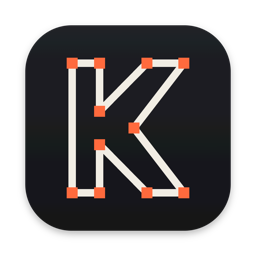
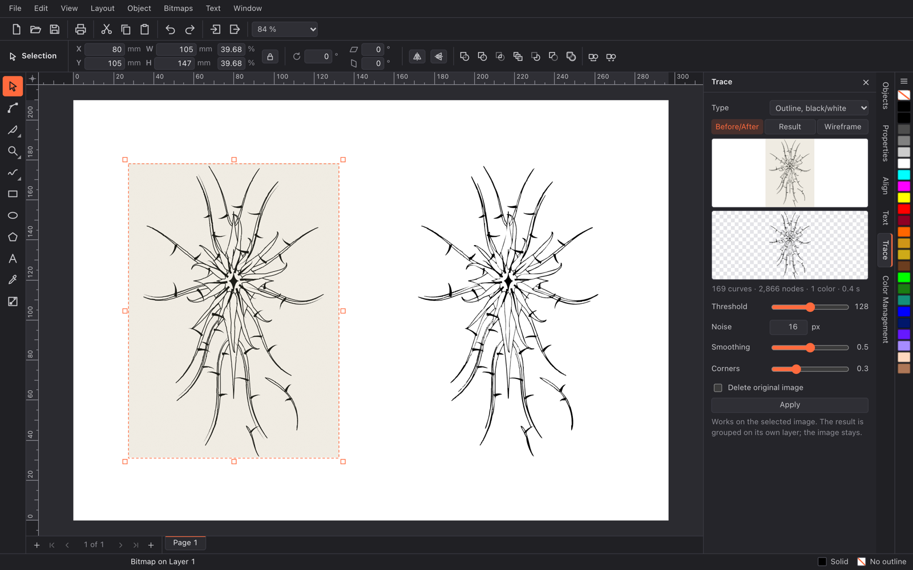
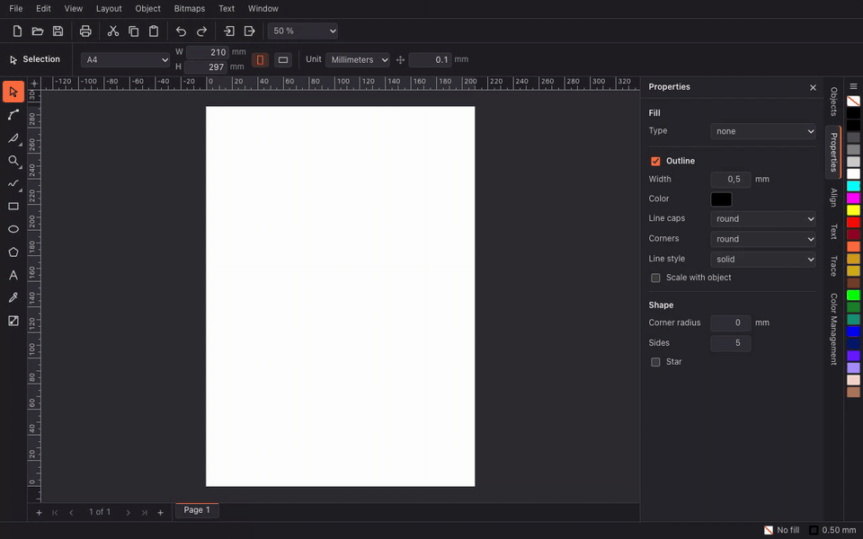
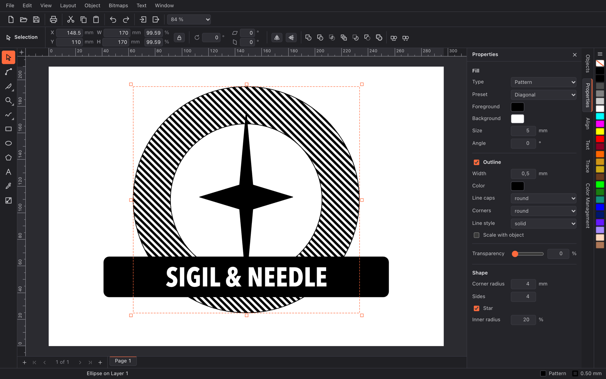

<p align="center">
  
</p>

<h1 align="center">KonturDraw</h1>

<p align="center">
  <b>The free vector editor for tattoo stencils and logos.</b><br>
  Works the way CorelDRAW users expect. Opens <code>.cdr</code> files. Runs on Mac and Windows.
</p>

<p align="center">
  <a href="https://github.com/Tomo214/konturdraw/releases/latest"><b>Download for macOS</b></a> ·
  <a href="https://github.com/Tomo214/konturdraw/releases/latest"><b>Download for Windows</b></a>
</p>

<p align="center">
  <a href="https://github.com/Tomo214/konturdraw/releases/latest"></a>
  
  
  <a href="LICENSE"></a>
</p>

<p align="center">
  
</p>

## Photo in, stencil out

Drop in a photo or a sketch, open the Trace panel and get clean vector lines you can still edit point by point.
Outline mode keeps every line exactly as drawn; centerline mode turns them into single strokes.

<p align="center">
  
</p>

## Why KonturDraw

- **No relearning.** Toolbox on the left, property bar on top, panels on the right, color palette on the edge, and the keyboard shortcuts you already have in your fingers.
- **Your old files still open.** `.cdr` import through [libcdr](https://wiki.documentfoundation.org/DLP/Libraries/libcdr), so years of designs are not locked in a subscription.
- **Made for the stencil job.** Trace, clean up, set the size in millimetres, print 1:1 or mirrored for transfer paper.
- **Small and fast.** An installer under 7 MB. Geometry, tracing, text layout and export run in Rust.

## Features

**Drawing and editing**
- Rectangle, ellipse, polygon and star, freehand, Bézier pen, text, eyedropper, interactive gradients
- Node editing with smoothing and node reduction
- Weld, trim, intersect, simplify, front minus back, back minus front, boundary, combine and break apart
- Knife and eraser
- Align and distribute, mirror, rotate, skew, exact position and size fields

**Tracing (bitmap → vector)**
- Centerline for line art and stencils
- Black-and-white outline for logos and lettering
- Color outline with 2–256 colors, optional background removal
- Live before/after, result-only and wireframe preview

**Fills, color and print**
- Solid, linear and radial gradient, two-color pattern fills, uniform transparency
- Place objects inside a frame (clipping) and take them out again
- RGB and CMYK, ICC profiles from your system, soft proof, spot colors, custom palettes
- Print 1:1 in millimetres, mirrored if you need it

**Documents**
- Multiple pages, layers you can hide, lock or exclude from printing
- Rulers, guides, grid, snapping, wireframe view
- Text with system fonts, text on a path, convert to curves
- Interface in English and German, switch any time under Window › Language

**Import and export**

| Import | Export |
|---|---|
| `.cdr` (CorelDRAW, via libcdr) | SVG |
| SVG | PDF (CMYK, bleed, crop marks) |
| PNG, JPG | PNG (any DPI, transparent) |
| own `.kwk` format | DXF, HPGL/PLT for cutters and plotters |

<p align="center">
  
</p>

## Download and install

Grab the latest build from [Releases](https://github.com/Tomo214/konturdraw/releases/latest).

**macOS** (Apple Silicon): open the `.dmg` and drag KonturDraw into Applications.
The app is not notarized yet, so macOS blocks the first start. Open *System Settings → Privacy & Security* and click *Open Anyway*, or run:

```bash
xattr -dr com.apple.quarantine /Applications/KonturDraw.app
```

**Windows** (10 and 11, x64): run the `-setup.exe`. The installer is not signed yet, so SmartScreen may warn you. Click *More info → Run anyway*.

## Status

KonturDraw is **early (0.1)**. Every feature above is built and covered by automated tests, but it has not been through months of daily studio use yet. Please [open an issue](https://github.com/Tomo214/konturdraw/issues) when something breaks or feels wrong.

Known gaps:
- Builds are unsigned (see the install notes above). No Intel Mac and no Linux build yet.
- `.cdr` files from CorelDRAW 2022 and newer only import partly (a libcdr limit).

## Build from source

You need Node.js 24 and a stable Rust toolchain.

```bash
git clone https://github.com/Tomo214/konturdraw.git
cd konturdraw
npm ci
npx tauri dev
```

`.cdr` import uses a small helper process. Build it once with `sh src/cdr-import/build.sh` (macOS needs [pixi](https://pixi.sh); on Windows run it in an MSYS2 UCRT64 shell). Tests: `npx vitest run` and `cargo test --workspace`.

Stack: [Tauri 2](https://tauri.app), [Svelte 5](https://svelte.dev), Rust. Architecture notes live in [`docs/architecture.md`](docs/architecture.md).

## Legal

KonturDraw is an independent project with its own code, design and name. It is not affiliated with, endorsed by or sponsored by Corel Corporation. CorelDRAW is a trademark of its owner and is mentioned here only to describe compatibility and workflow.

`.cdr` import is based on libcdr and librevenge (MPL-2.0); the changes to libcdr are in [`src/cdr-import/patches`](src/cdr-import/patches).

## License

KonturDraw is released under the [MIT License](LICENSE): use it, change it and share it, commercially too.

Third-party files keep their own licenses: the libcdr patch in `src/cdr-import/patches` and the test file `tests/fixtures/cdr/fdo65220-2.cdr` (from LibreOffice) are MPL-2.0, the test font `tests/fixtures/fonts/Tuffy.ttf` is public domain. The KonturDraw name and logo are not covered by the license, so forks need a name of their own.
